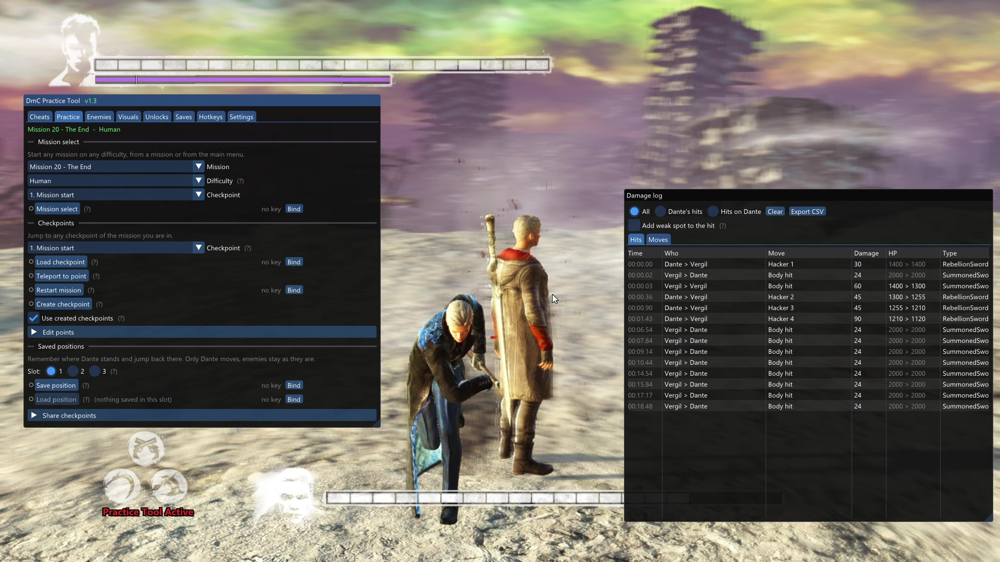
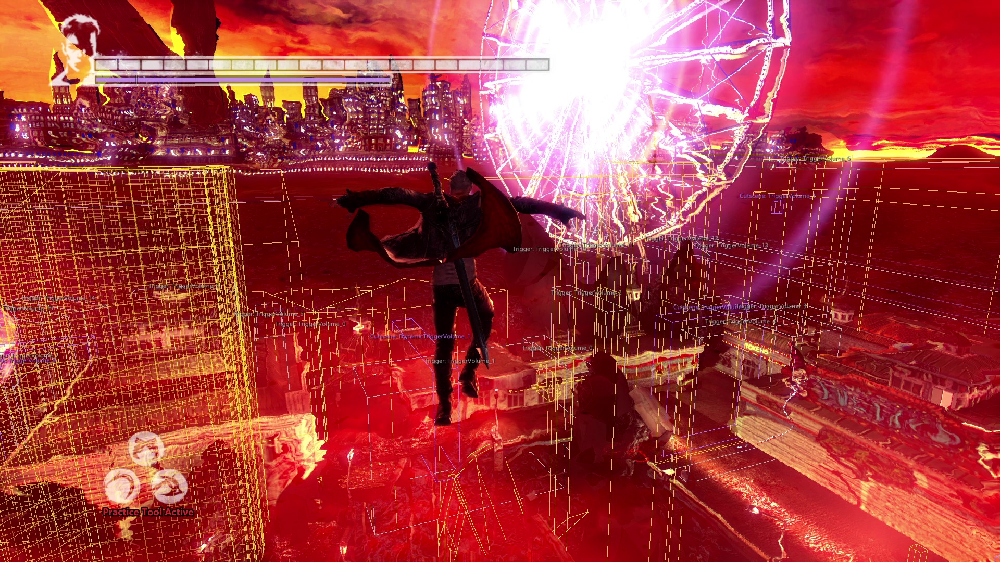

# DmC Practice Tool

A practice and training tool for **DmC: Devil May Cry** (PC, Steam): cheats, checkpoints, enemy spawner, damage log,
hitbox view and one-click unlocks — all in an in-game menu.

  
  

## Installation

1. Download `DmCPracticeTool_vX.Y.Z.zip` from [Releases](https://github.com/billymooreq/DmC-DevilMayCry-Practice-tool/releases).
2. Open the game folder: in Steam, right-click **DmC Devil May Cry** → **Manage** → **Browse local files**.
3. Go to `Binaries\Win32` and put `dinput8.dll` from the zip there (next to `DMC-DevilMayCry.exe`).
4. Start the game.
5. Press **Insert** to open or close the menu.

**To remove the tool**, delete `dinput8.dll` from `Binaries\Win32`. Your game files are not changed.

Good to know before you start:

- You need the **Steam version** of the game. Both the current version (**v1.3**) and the original 2013
  release (**v1.0**) work. The tool finds out which one you have by itself and shows it at the top of the menu.
- The game must run in **DirectX 9** mode. This is the game's default, so usually you don't need to do anything.
- **Steam Deck / Linux (Proton):** in the game's Steam properties, set the launch options to
  `WINEDLLOVERRIDES="dinput8=n,b" %command%`. Proton is not tested yet — please tell us if it works.
- Other mods that also use a file called `dinput8.dll` (for example the old "Console & Debug Menu" mod) can't be
  used at the same time. Only one `dinput8.dll` can be in the folder.

## Features

The menu has tabs. They are listed here in the same order as in the menu. Most features can get a hotkey (see
Hotkeys). Features only work inside a mission.

### Cheats

**Player**
- **Infinite HP** — Dante never loses health and can't die from hits.
- **Infinite DT** — the Devil Trigger gauge stays full.
- **Infinite Glide** — use Angel Glide / Angel Boost again and again without landing. Two modes: unlimited boosts
  or level flight.
- **Noclip** — fly through walls (WASD, Space up, Ctrl down, Shift faster).
- **One-hit KO on player** — any hit kills Dante (option: no Gold Orb revive).
- **Damage taken** — make hits on Dante weaker or stronger (0× to 10×).
- **Player speed** — speed up or slow down only Dante.

**Enemies**
- **One-hit kills** — any hit from Dante kills the enemy.
- **Damage dealt** — make Dante's hits weaker or stronger (0× to 10×).
- **Enemy speed** — speed up or slow down only the enemies.

**Game**
- **Game speed** — speed up or slow down the whole game (0.1× to 10×).

### Practice

- **Mission select** — load any mission, difficulty and checkpoint, even from inside another mission.
- **Load checkpoint** — load the current mission at the checkpoint you pick.
- **Teleport to point** — move only Dante to a point, without resetting the level.
- **Restart mission** — start the mission again from the beginning.
- **Create checkpoint** — save a copy of the game's own checkpoint to come back to it any time.
- **Save / Load position** — remember where Dante stands (3 slots) and put him back there.
- **Edit points** — rename, reorder or delete checkpoints in the list.
- **Share checkpoints** — save your list to a file or use a list from a friend.

### Enemies

- **Spawn** — spawn any normal enemy (1–10 of them), in front of Dante or at a saved position.
- **Kill all enemies** / **Despawn spawned** — clear the room, or remove only the enemies you spawned.
- **Infinite enemy HP** — enemies can't die: a training dummy for combos.
- **Show enemy HP** — the enemy's health as a number above its head.
- **Damage log** — a small window with every hit: who hit whom, the move name, the damage and the health left.
  Can be saved as a CSV file.

### Visuals

- **Enemy collision / Player collision** — the body shapes that hits are checked against.
- **Attack hitboxes** — the area each attack can hit, while it is active.
- **Hit markers** — a small star where a hit really landed.
- **Cutscene / Arena / Other triggers** — the areas that start a cutscene, a fight or a script when Dante walks in.
- **Invisible walls** — the walls you can't see that stop Dante (with an optional 1 m grid).
- **Options** — labels, max distance, line width, and hiding lines behind walls.

### Unlocks

- **Unlock All** — the whole game at 100%: all missions on all difficulties, secret missions, Mundus Keys, Lost
  Souls, upgrades and skills, HP and DT ups, costumes, concept art. Your ranks and scores are not touched.
- **Separate unlocks** — any of the parts above on its own.
- **Set all ranks SSS** — SSS on every completed mission.

Works in the main menu after you pick your save slot. A backup of your save is made first.

### Saves

- **Import** — load a save that someone sent you (a `.dmcpt` file) into any slot.
- **Export** — save one of your slots as a `.dmcpt` file to share.

### Hotkeys

- Give any feature a key or a gamepad button combination.
- **Presets** — several features with their own settings on one key.

### Settings

- Change the menu key, save or load your settings.
- **Compatibility report** — helps us add support for other game versions (see FAQ).

### Several features on one key (presets)

1. Open **Hotkeys** → **Presets** and press **+ New preset**.
2. Pick the features for it (for example Infinite HP + Infinite Glide + Noclip) and their settings.
3. Give the preset a key. Press it once to turn everything on, press it again to turn it off.

Buttons from the Practice tab (like Load checkpoint) can also go into a preset: they run once when the preset
turns on.

### Share a save with a friend

1. **Saves** → **Export**: pick the slot, give it a name and press **Export**.
2. Press **Open export folder** and send the `.dmcpt` file to your friend.
3. Your friend puts the file into the import folder (**Saves** → **Open import folder**), then presses
   **Import...** and picks a slot.

The file is not tied to your Steam account, so it works on any PC.

### Share a checkpoint list

1. **Practice** → **Share checkpoints** → **Save my list to a file**.
2. Send the `.dmcptset` file from the `DmCPT_sets` folder.
3. Your friend puts it into their `DmCPT_sets` folder and presses **Use this list**.

The built-in list (**Default checkpoints**) is always there if you want to go back to it.

## Good to know

- **"Practice Tool Active"** appears on screen after you use the first cheat and stays until you restart the
  game. This is on purpose, so runs and streams with the tool are easy to tell apart.
- **Steam achievements are blocked** after you use any cheat, until you restart the game.
- Cheats, Practice, Enemies and Visuals work **only inside a mission**.
- **Unlock** makes a backup of your save first, in `Binaries\Win32\DmCPT_backups\` (one folder per backup,
  named with the date and time).
- **To restore a save from a backup:** close the game, then copy the files from the backup folder into your Steam
  save folder: `Steam\userdata\<your number>\220440\remote\`. If Steam asks about a Cloud conflict, choose the
  **local** files.
- Your settings are kept in `Binaries\Win32\DmCPracticeTool.json`.

## Both game versions on one PC

v1.0 and v1.3 use **the same save files** (the same Steam folder `Steam\userdata\<your number>\220440\remote`).
Progress made in one version is there in the other one too.

- **v1.0 shows a save made in v1.3 as "NEW SAVE".** The save is still there: pick the slot and your progress
  loads as usual. Do not start a new game in that slot — that would overwrite it.
- Both versions use the same save format. Still, **back up your saves before switching between versions**
  (copy the `remote` folder somewhere).
- A save file from **Export** made in the other version shows a yellow note "made on game version ..."; you can
  still import it.

## Troubleshooting / FAQ

**The menu does not open.**
Check that `dinput8.dll` is in `Binaries\Win32` (not in the main game folder). Press **Insert** in the game
window. If `DmCPracticeTool.log` does not appear in that folder after starting the game, the tool was not loaded:
check for another `dinput8.dll` mod, and on Steam Deck the launch option above.

**The menu shows a red "unknown build".**
The tool does not know your version of the game yet, so all features are locked to keep your game safe. Please
help us add it: open **Settings** → **Compatibility report** → **Create report** and send us the file
`DmCPT_compat_report.txt` (it appears in `Binaries\Win32`, the **Open folder** button opens it). The report only
says which game version you have and what the tool can find in it — no personal data. Open an
[issue](https://github.com/billymooreq/DmC-DevilMayCry-Practice-tool/issues) and attach the file.

**The menu is not visible in my OBS recording.**
Close the game, open `Binaries\Win32\DmCPracticeTool.json` in Notepad and change `"render"` in the `"hooks"`
section from `"vtable"` to `"present"` (or `"endscene"`). Start the game again.

**The game does not start after installing the tool.**
Delete `dinput8.dll` and check that the game starts without it. If it does, please open an issue and attach
`DmCPracticeTool.log` from `Binaries\Win32`.

## Technical details

For people who want to know how it works or build it themselves:

- [docs/TECHNICAL.md](docs/TECHNICAL.md) — how the tool works, file formats, supported game builds.
- [docs/BUILDING.md](docs/BUILDING.md) — building from source and the project structure.

## Credits, licenses, disclaimer

- This is an **unofficial fan project**. It is not made, supported or approved by Capcom or Ninja Theory.
  DmC: Devil May Cry is a trademark of its owners.
- **Use at your own risk.** Make a backup of your saves before using Unlock or Import.
- The tool is released under the [MIT license](LICENSE).
- It uses [Dear ImGui](https://github.com/ocornut/imgui) (MIT), [MinHook](https://github.com/TsudaKageyu/minhook)
  (BSD 2-Clause) and [nlohmann/json](https://github.com/nlohmann/json) (MIT). Their licenses are in
  `third_party/`.
- The built-in checkpoint list was put together by hand by the author.
