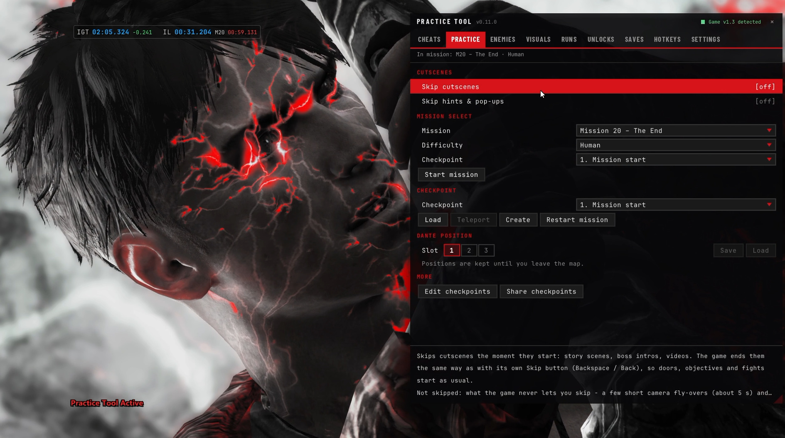
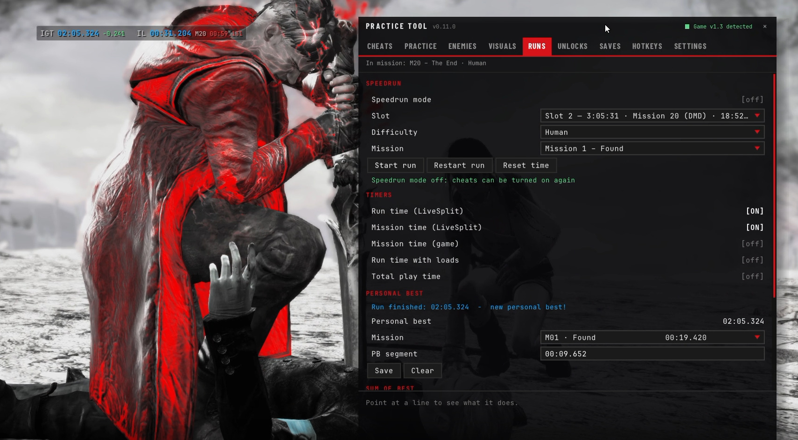

# DmC Practice Tool

A practice and training tool for **DmC: Devil May Cry** (PC, Steam): cheats, mission and checkpoint select, enemy
spawner, damage log, hitbox view, speedrun timers and one-click unlocks — all in an in-game menu.

  

  

## Installation

1. Download `DmCPracticeTool_vX.Y.Z.zip` from [Releases](https://github.com/billymooreq/DmC-DevilMayCry-Practice-tool/releases).
2. Open the game folder: in Steam, right-click **DmC Devil May Cry** → **Manage** → **Browse local files**.
3. Go to `Binaries\Win32` and put `dinput8.dll` from the zip there (next to `DMC-DevilMayCry.exe`).
4. Start the game.
5. Press **Insert** to open or close the menu.

**To update**, replace `dinput8.dll` with the new one. Your settings, checkpoints and best times stay.

**To remove the tool**, delete `dinput8.dll` from `Binaries\Win32`. Your game files are not changed.

Good to know before you start:

- Works with the **Steam version** of the game: both the current version (**v1.3**) and the original 2013
  release (**v1.0**). **Non-Steam copies of v1.3** work too — the menu shows them as "v1.3 nonsteam", and Saves
  (Import / Export) use the place where that copy keeps its saves. The tool finds out which version you have by
  itself and shows it at the top of the menu.
- The game must run in **DirectX 9** mode. This is the game's default, so usually you don't need to do anything.
- **Steam Deck / Linux (Proton):** in the game's Steam properties, set the launch options to
  `WINEDLLOVERRIDES="dinput8=n,b" %command%`. Proton is not tested yet — please tell us if it works.
- Other mods that also use a file called `dinput8.dll` (for example the old "Console & Debug Menu" mod) can't be
  used at the same time. Only one `dinput8.dll` can be in the folder.

## The menu

- The menu is a list. Point at any line and a short help text appears at the bottom.
- Drag the edges of the menu window to make it bigger or smaller — the text grows with it.
  **Settings** → **Reset window size and position** puts it back.
- **Numbers:** drag the slider, use the arrows, or click the number and type any value (for example a game speed
  above the slider's end).
- Some features win over others, so you never get a mix that makes no sense. For example **Infinite HP** wins over
  **One-hit KO on player** and **Damage taken**, and **One-hit kills** wins over **Damage dealt**.
- Multipliers (damage, speed) work as soon as you move them away from 1×. There is nothing to tick.

## Features

The sections below follow the tabs of the menu. Most features can get a key or a gamepad button combination in
**Hotkeys**. Cheats, Practice, Enemies and Visuals work inside a mission.

### Cheats

**Player**
- **Infinite HP** — Dante never loses health and can't die from hits.
- **One-hit KO on player** — any hit kills Dante (option: no Gold Orb revive).
- **Infinite DT** — the Devil Trigger gauge stays full.
- **Infinite Glide** — use Angel Glide / Angel Boost again and again without landing. Two modes: unlimited boosts
  or level flight.
- **Noclip** — fly through walls (WASD, Space up, Ctrl down, Shift faster), with a fly speed setting.

**Enemies**
- **One-hit kills** — any hit from Dante kills the enemy.
- **Infinite enemy HP** — enemies can't die: a training dummy for combos.
- **Kill all enemies** — clears the room.

**Damage**
- **Damage dealt / Damage taken** — make hits weaker or stronger.

**Speed**
- **Game speed** — speed up or slow down the whole game (slider up to 10×, or type any number).
- **Player speed / Enemy speed** — only Dante, or only the enemies.

**Camera**
- **Unlock camera** — you control the camera everywhere: no fixed camera angles, no automatic turning or lock-on
  camera.

### Practice

- **Skip cutscenes** — cutscenes end the moment they start, the same way the game's own Skip button does.
- **Skip hints & pop-ups** — closes "new item / weapon / ability" windows and tutorial hints by itself, and starts
  secret missions without the "press to begin" screen.
- **Mission select** — load any mission, difficulty and checkpoint, from the main menu or from inside another
  mission.
- **Dev room** — the developers' own test arena: flat open ground, no story. Spawn any enemy there and practice.
  (Game v1.3 only: game v1.0 crashes on this map.)
- **Load checkpoint** — load the current mission at the checkpoint you pick.
- **Teleport** — move only Dante to a checkpoint, without resetting the level.
- **Restart mission** — start the mission again from the beginning.
- **Create** — play to a checkpoint normally, then press Create: the checkpoint the game just saved becomes your
  own and loads exactly like Continue. **Delete my checkpoint** removes it again.
- **Dante position** — remember where Dante stands (3 slots) and put him back there.
- **Edit checkpoints** — rename, reorder or delete checkpoints in the list.
- **Share checkpoints** — save your list to a file or use a list from a friend.

### Enemies

- **Spawn** — spawn any normal enemy, as many as you like, in front of Dante or at one of 3 saved enemy positions
  (positions 4–6, separate from Dante's 1–3). **Save here as 4/5/6** saves where Dante stands as an enemy position.
- **Kill all enemies** / **Despawn spawned** — clear the room, or remove only the enemies you spawned.
- **Show enemy HP** — health number and a small bar above every enemy.
- **Damage log** — a small window with every hit: the move, who it hit, the damage and the health left.
  - Show all hits, only Dante's hits, or only hits on Dante; a list of hits or a summary by move.
  - **Weak spot** — show hits on an enemy's weak spot as part of the hit or as their own line.
  - **Hide log in-game** — the window is only shown while the menu is open (hits are still counted).
  - **Clear log** and **Export CSV** (to open in Excel or Google Sheets).

### Visuals

- **Enemy collision / Player collision** — the body shapes that hits are checked against.
- **Attack hitboxes** — the area each attack can hit, while it is active (Dante's and the enemies').
- **Explosions & area damage** — explosions, shock waves, poison and other damage zones while they can hurt, and
  grenades and bombs in flight.
- **Hit markers** — a small star where a hit really landed.
- **Level hazards** — parts of the level that hurt when touched (fire, spikes, poison, pits).
- **Cutscene / Arena / Other triggers** — the areas that start a cutscene, a fight or a script when Dante walks in.
- **Invisible walls** — the walls you can't see that stop Dante (with an optional 1 m grid).
- **Options** — labels, max distance, line width, and hiding lines behind walls.

### Runs

For speedrunners. The timers follow the speedrun leaderboard's rules (the same as the community LiveSplit
autosplitter): loading screens don't count.

**Speedrun**
- **Speedrun mode** — turns every cheat off at once, removes the "Practice Tool Active" label and keeps cheats off
  until you turn it off. Timers and the Runs buttons keep working.
- **Start run** — pick a save slot, difficulty and mission, press Start run: the tool loads the slot and starts
  the mission for you, from the title screen, the main menu or another mission.
- **Restart run** — the same again, with the run time back to zero. **Reset time** — only the timers back to zero.

**Timers** (shown on screen above the health bar; move them while the menu is open)
- **Run time (LiveSplit)** — the whole run, without loading screens. On screen: **IGT**. Green while it runs,
  blue when the run is over (Vergil is beaten in Mission 20).
- **Mission time (LiveSplit)** — the current mission. On screen: **IL**.
- **Mission time (game)** — the game's own mission timer. On screen: **GAME**.
- **Run time with loads** — real time, loading screens included. On screen: **RTA**.
- **Total play time** — the save's total play time. On screen: **TOTAL**.

**Best times**
- **Personal best** — your best full run (Mission 1 to the end). Next to IGT you see how far ahead (−, green) or
  behind (+, red) of it you are; next to IL — the last mission's time (yellow = your best ever for that mission).
- **Sum of best** — your best time of every mission added up.
- Both are kept between game starts, and you can edit the time of each mission by hand.

### Unlocks

- **Unlock All** — the whole game at 100%: all missions on all difficulties, secret missions, Mundus Keys, Lost
  Souls, upgrades and skills, HP and DT ups, costumes, concept art. Your ranks and scores are not touched.
- **Unlock one part** — any of the parts above on its own.
- **Set all ranks SSS** — SSS on every completed mission.

Works in the main menu after you pick your save slot. A backup of your save is made first.

### Saves

- **Import** — load a save that someone sent you (a `.dmcpt` file) into any slot.
- **Export** — save one of your slots as a `.dmcpt` file to share.

### Hotkeys

- The only place to set keys. Give any feature a keyboard key (with Ctrl / Shift / Alt if you like) or a gamepad
  button combination. Press once — on, again — off.
- **Presets** — several features with their own settings on one key.

### Settings

- **Menu key** — open and close the menu with any key or a gamepad button combination.
- **Pause the game while the menu is open.**
- **Disable hints** — hides the help text at the bottom of the menu.
- **Game window** — **Fullscreen**, **Borderless** (a full-screen window: Alt+Tab is instant, LiveSplit or OBS can
  stay on top) or **Window** (move it and drag its edges). Picking one restarts the game at once by itself (a few
  seconds; progress since the last checkpoint is lost).
- **Unlock the game's debug menu** — hold Angel + Demon and press Pause to open the developers' own debug menu.
- **Save config / Load config**, **Compatibility report** (see FAQ), **About**.

### Several features on one key (presets)

1. Open **Hotkeys** → **Presets** and press **+ New preset**.
2. Pick the features for it (for example Infinite HP + Infinite Glide + Noclip) and their settings.
3. Give the preset a key. Press it once to turn everything on, press it again to turn it off.

Buttons from the Practice tab (like Load checkpoint) can also go into a preset: they run once when the preset
turns on.

### Share a save with a friend

1. **Saves** → **Export**: pick the slot, give it a name and press **Export**.
2. Press **Open export folder** and send the `.dmcpt` file to your friend.
3. Your friend puts the file into the import folder (**Saves** → **Open import folder**), then presses
   **Import...** and picks a slot.

The file is not tied to your Steam account, so it works on any PC.

### Share a checkpoint list

1. **Practice** → **Share checkpoints** → **Save my list to a file**.
2. Send the `.dmcptset` file from the `DmCPT_sets` folder.
3. Your friend puts it into their `DmCPT_sets` folder and presses **Use this list**.

The built-in list (**Default checkpoints**) is always there if you want to go back to it.

## Good to know

- **"Practice Tool Active"** appears on screen after you use the first cheat and stays until you restart the
  game (or turn on **Speedrun mode**). This is on purpose, so runs and streams with the tool are easy to tell apart.
  Timers, Unlocks, Saves and the menu itself don't show it.
- **Steam achievements are blocked** after you use any cheat, until you restart the game.
- **Unlock** and **Import** make a backup of your save first, in `Binaries\Win32\DmCPT_backups\` (one folder per
  backup, named with the date and time).
- **To restore a save from a backup:** close the game, then copy the files from the backup folder into your Steam
  save folder: `Steam\userdata\<your number>\220440\remote\`. If Steam asks about a Cloud conflict, choose the
  **local** files.
- Your settings are kept in `Binaries\Win32\DmCPracticeTool.json`, your best times in `DmCPT_timers.json`.

## Both game versions on one PC

v1.0 and v1.3 use **the same save files** (the same Steam folder `Steam\userdata\<your number>\220440\remote`).
Progress made in one version is there in the other one too.

The two versions write the text on the "Choose save slot" screen differently, so it can look wrong in the other
version. Only the text is affected — your progress is always there:

- **v1.0 shows a save made in v1.3 as "NEW SAVE".** Pick the slot and your progress loads as usual. Do not start
  a new game in that slot — that would overwrite it.
- **After you play a save in v1.0, v1.3 may show old text for it** (old play time, mission, date). Pick the slot
  and everything is up to date.
- **Saves → Import** works in both directions. A save file made in the other version shows a yellow note
  "made on game version ..."; you can still import it, and the slot text is made so that both versions show it.
- Back up your saves before switching between versions (copy the `remote` folder somewhere).

## Troubleshooting / FAQ

**The menu does not open.**
Check that `dinput8.dll` is in `Binaries\Win32` (not in the main game folder). Press **Insert** in the game
window. If `DmCPracticeTool.log` does not appear in that folder after starting the game, the tool was not loaded:
check for another `dinput8.dll` mod, and on Steam Deck the launch option above.

**The menu shows a yellow "Game version undetected".**
The tool does not know your version of the game. You can still use everything, but some things may not work.
Please help us add it: open **Settings** → **Compatibility report** → **Create report** and send us the file
`DmCPT_compat_report.txt` (it appears in `Binaries\Win32`, the **Open report folder** button opens it). The report
only says which game version you have and what the tool can find in it — no personal data. Open an
[issue](https://github.com/billymooreq/DmC-DevilMayCry-Practice-tool/issues) and attach the file.

**The menu is not visible in my OBS recording.**
Close the game, open `Binaries\Win32\DmCPracticeTool.json` in Notepad and change `"render"` in the `"hooks"`
section from `"vtable"` to `"present"` (or `"endscene"`). Start the game again.

**The game does not start after installing the tool.**
Delete `dinput8.dll` and check that the game starts without it. If it does, please open an issue and attach
`DmCPracticeTool.log` from `Binaries\Win32`.

## Technical details

For people who want to know how it works or build it themselves:

- [docs/TECHNICAL.md](docs/TECHNICAL.md) — how the tool works, file formats, supported game builds.
- [docs/BUILDING.md](docs/BUILDING.md) — building from source and the project structure.

## Credits, licenses, disclaimer

- This is an **unofficial fan project**. It is not made, supported or approved by Capcom or Ninja Theory.
  DmC: Devil May Cry is a trademark of its owners.
- **Use at your own risk.** Make a backup of your saves before using Unlock or Import.
- The tool is released under the [MIT license](LICENSE).
- It uses [Dear ImGui](https://github.com/ocornut/imgui) (MIT), [MinHook](https://github.com/TsudaKageyu/minhook)
  (BSD 2-Clause) and [nlohmann/json](https://github.com/nlohmann/json) (MIT). Their licenses are in
  `third_party/`.
- Fonts: [JetBrains Mono](https://github.com/JetBrains/JetBrainsMono) and
  [Barlow Condensed](https://github.com/jpt/barlow), both under the SIL Open Font License 1.1
  (`third_party/fonts/OFL_*.txt`).
- The speedrun timers follow the rules of the community's LiveSplit autosplitter for DmC.
- The built-in checkpoint list was put together by hand by the author.
